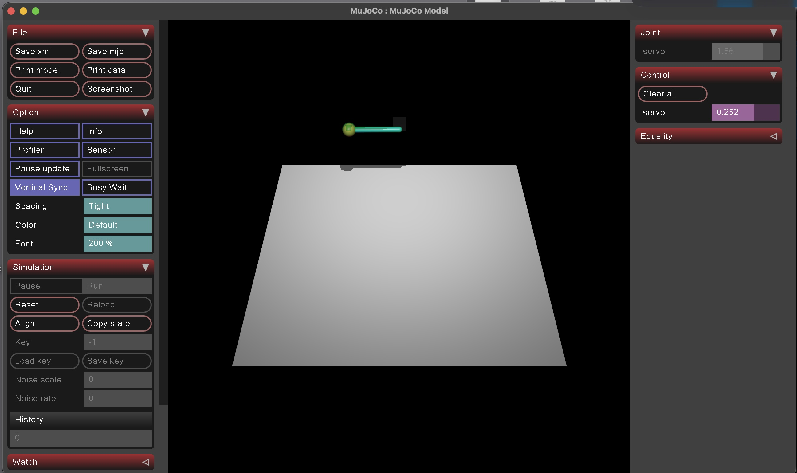
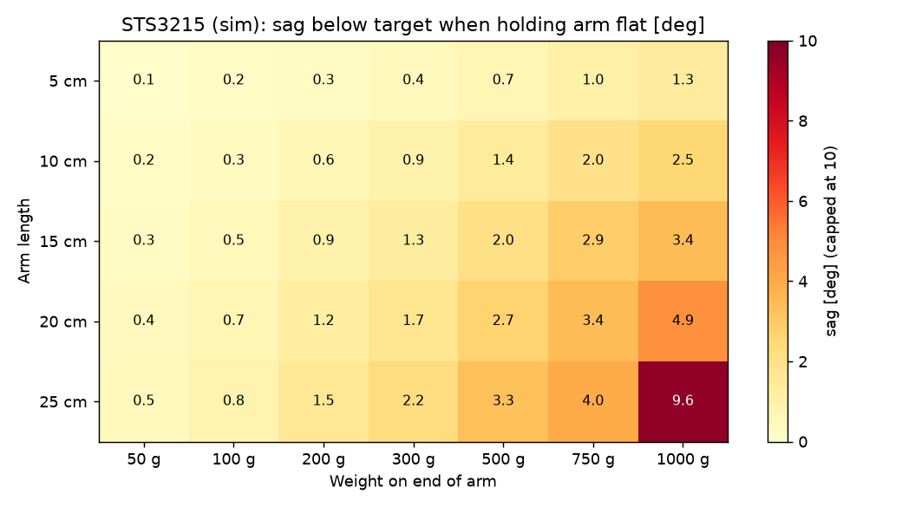

# Bipedal Robotics: Servo Modeling with BAM

Our team is building a small walking (bipedal) robot. Before a robot learns to walk in a computer simulation, the simulated motors have to behave like the real ones. If they don't, a walk that works in simulation falls over in real life.

This project makes the simulation of our motor, the **Feetech STS3215** servo, match the real thing. It uses [BAM (Better Actuator Models)](https://github.com/Rhoban/bam), an open-source tool from the Rhoban robotics team that models motor friction much more accurately than standard simulators.

*Georgia Tech VIP, Fall 2026, by Aarin Karamchandani*

## What we've done so far

| Week | What we did |
|---|---|
| 1–2 | Read the BAM paper and code. Learned its six friction models (m1 is the simplest, m6 the most detailed). |
| 3 | Ran our first simulation: one STS3215 lifting a 100 g weight on a 15 cm arm. |
| 4–5 | Tested 35 arm-length and weight combinations in simulation to plan our test rig. |
| 6 | Built a one-command pipeline that checks a servo model against recordings and fits a better one. |
| 7 | Wrote a script to record our real servos safely, plus a practice mode that works without hardware. |
| 8 | Built a tool that compares a whole robot to its simulation, joint by joint. |

The full week-by-week notes are in [docs/progress-log.md](docs/progress-log.md).



## Key results

**1. Test-rig sizing.** We simulated how much the servo sags when it holds its arm flat with different weights. It handles almost everything. Only 1 kg on a 25 cm arm is a problem (9.6° of sag). Our recommended rig uses **10–20 cm arms with 100–750 g weights**.



**2. Model check on practice recordings.** We made 12 practice recordings and ran them through the pipeline. It correctly picked BAM's detailed model as the best match. Error is the average distance, in degrees, between where the simulated arm is and where the recorded arm is.

| Model | Average error |
|---|---|
| BAM simple model (m1) | 1.70° |
| BAM detailed model (m6) | **0.42°** |
| Our fitted simple model (m1) | 0.64° |

**3. Whole-robot check on a fake 3-joint arm.** BAM's detailed model matched about **twice as well** as the simple one (0.21° vs. 0.43° average error). The tool also catches setup mistakes: when we set the elbow 4° off on purpose, it noticed and suggested the fix.

## What's in this repo

| File | What it does |
|---|---|
| `test_sts3215.py` | Simulates one servo lifting a weight and plots the result |
| `test_sts3215_live.py` | Same, but opens a live 3D viewer |
| `rig_sweep_sts3215.py` | Tries many arm lengths and weights to plan the test rig |
| `bam_pipeline.py` | One command: check BAM's models on recordings, fit a new one, write a report |
| `record_sts3215.py` | Records a real STS3215 on the test rig (or a simulated one with `--practice`) |
| `robot_compare.py` | Compares a whole robot to its simulation, joint by joint |
| `make_fake_robot.py` | Makes a fake 3-joint arm and recording for testing `robot_compare.py` |
| `results/`, `robot_results/` | Reports and charts from our test runs |
| `data_raw/` | The 12 practice recordings |

## How to run it

You need [uv](https://docs.astral.sh/uv/). It installs Python 3.12 and BAM for you.

```bash
uv sync

# Simulate one servo
uv run python test_sts3215.py

# Plan the test rig
uv run python rig_sweep_sts3215.py

# Make practice recordings, then check and fit models on them
uv run python record_sts3215.py --practice --mass 0.2 --length 0.15 --arm-mass 0.02
uv run python bam_pipeline.py --raw data_raw

# Compare a (fake) robot to its simulation
uv run python make_fake_robot.py
uv run python robot_compare.py --robot fake_robot.xml --recording fake_robot_recording.csv
```

To record a real servo, install the hardware extra first: `uv sync --extra hardware`.

## Next steps

- Build the physical test rig and record our real STS3215 servos.
- Run the pipeline on those real recordings.
- Turn our robot's SolidWorks design into a simulation file and compare it to the real robot.

## Credits

- BAM is by Marc Duclusaud and Grégoire Passault (Rhoban), released under the Apache 2.0 license: [github.com/Rhoban/bam](https://github.com/Rhoban/bam).
- Paper: [*Extended Friction Models for the Physics Simulation of Servo Actuators*](https://arxiv.org/abs/2410.08650).
